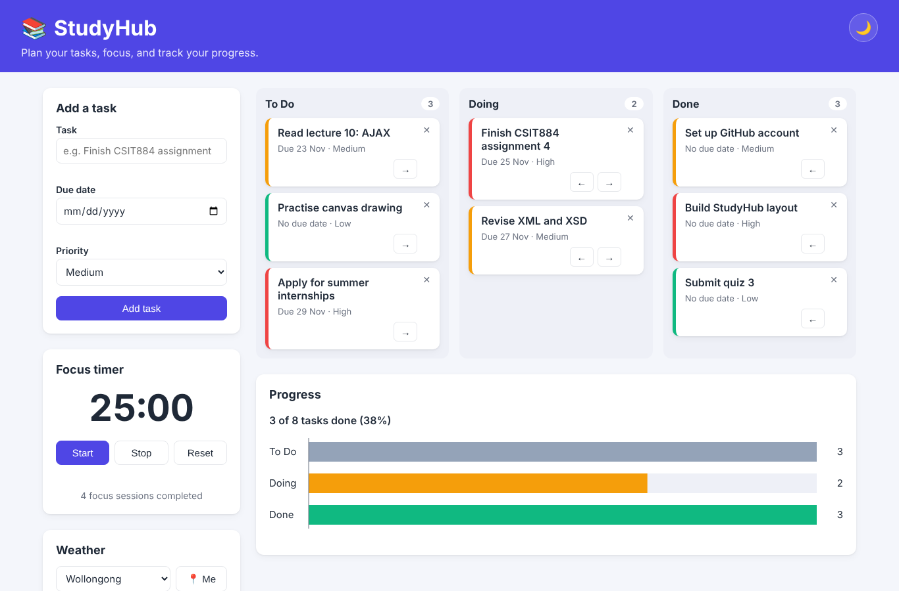
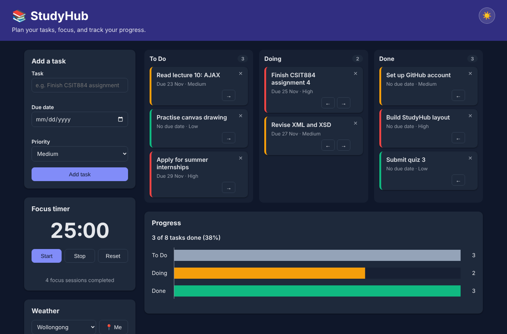
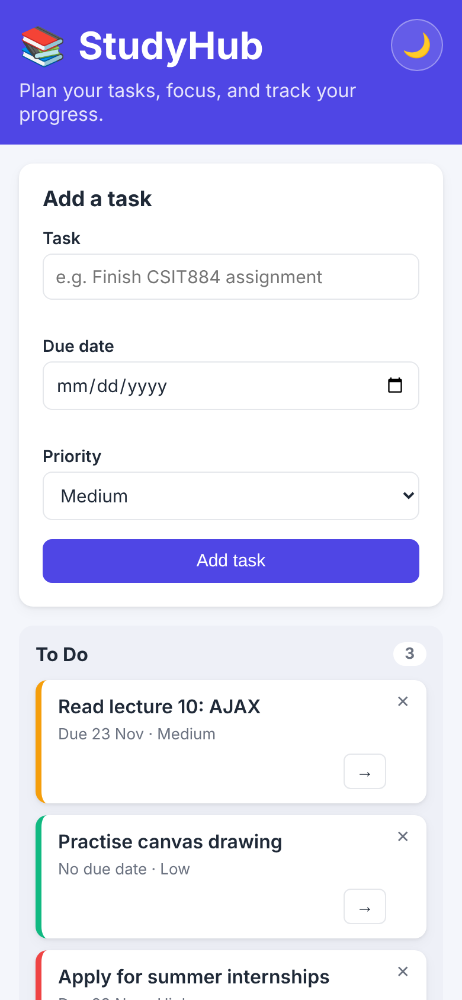

# 📚 StudyHub: Student Productivity Dashboard

A study dashboard for university students: plan tasks on a drag-and-drop Kanban board, focus with a Pomodoro timer, track progress on a live chart and check the weather. Everything is built with **plain HTML, CSS and JavaScript, with no frameworks or libraries**.

**🔗 Live demo:** https://YOUR-GITHUB-USERNAME.github.io/studyhub/



---

## ✨ Features

| Feature | Details |
|---|---|
| 🗂️ **Kanban board** | Drag tasks between **To Do → Doing → Done**, or use the ← → buttons (these work on phones too) |
| 💾 **Saves automatically** | Tasks, theme, city and focus sessions are kept in `localStorage`, so nothing is lost on refresh |
| ✅ **Form validation** | Friendly inline errors: required name, 3–60 characters, no duplicates, no past due dates |
| ⏱️ **Focus timer** | 25-minute Pomodoro timer with Start / Stop / Reset; stays accurate in background tabs; shows the time on the browser tab |
| 📊 **Progress chart** | Hand-drawn on `<canvas>`, updates live, sharp on high-resolution screens |
| 🌦️ **Weather widget** | Live data from the [Open-Meteo API](https://open-meteo.com/), with a city picker or "use my location" |
| 📤 **Export** | Download your tasks as **XML** (checked by an included **XSD schema**) or **JSON** |
| 🌙 **Dark mode** | Follows your system setting and remembers your choice |
| 📱 **Responsive** | Works on desktop, tablet and phone |
| ♿ **Accessible** | Keyboard focus outlines, screen-reader labels and live announcements, and reduced motion respected |

<p>
  
  &nbsp;
  
</p>

---

## 🛠️ Built with

- **HTML5**: semantic layout (`header`, `main`, `aside`, `section`), forms, `<canvas>`
- **CSS3**: custom properties (variables) for theming, Grid and Flexbox, media queries, transitions and keyframe animations
- **JavaScript (ES6+)**: DOM manipulation, events, `fetch` with `async`/`await`, the Drag and Drop API, the Canvas API, the Geolocation API, `localStorage`, JSON, and XML generation with `XMLSerializer`
- **XML + XSD**: export format and schema validation

## 🎓 What I learned

I built StudyHub to put every topic from my university web development subject (CSIT884, University of Wollongong) into one real application:

| Course topic | Where it's used in StudyHub |
|---|---|
| HTML & CSS | Page layout, card design, responsive grid, dark theme |
| JavaScript events | Buttons, form submit, drag events, window resize |
| Web forms & validation | Add-task form with custom error messages (`js/validation.js`) |
| Animation (`setInterval`) | Focus timer (`js/timer.js`) |
| DOM | Task cards created and redrawn from data (`js/tasks.js`) |
| JSON | Saving tasks to `localStorage`, JSON export |
| AJAX | Weather from the Open-Meteo API (`js/weather.js`) |
| Drag and drop | Kanban board (`js/dragdrop.js`) |
| Canvas | Progress chart (`js/chart.js`) |
| XML & XSD | XML export + schema (`js/export.js`, `xml/studyhub-tasks.xsd`) |

The course taught older patterns (`var`, inline `onclick`, `XMLHttpRequest`). StudyHub uses the modern equivalents (`const`/`let`, `addEventListener`, `fetch`), and every change is explained in a code comment starting with `MODERN:`.

## 🧩 Challenges I solved

- **Drops landing on the wrong element.** Dropping a task on top of another card made `event.target` point to that card, not the column. Using `event.currentTarget` (the element the listener is attached to) fixed it.
- **Timer drift.** Browsers slow down `setInterval` in background tabs, so a counter that subtracts 1 every second falls behind. The timer now calculates the time left from a fixed end time (`endTime - Date.now()`), so it stays exact.
- **Blurry chart.** A canvas stretched by CSS looks blurry on high-resolution screens. I resize it with `devicePixelRatio` before each draw.
- **Safe user input.** Task names are inserted with `textContent` instead of `innerHTML`, so typed HTML can't run as code (XSS). The XML export uses the DOM, so characters like `&` and `<` are escaped automatically.
- **A board that flickered.** The fade-in animation replayed on every card at each redraw. Now only cards created in the last second animate.
- **Drag and drop on phones.** HTML5 drag and drop doesn't work on touch screens, so every card also has ← → move buttons.

## 📁 Project structure

```
studyhub/
├── index.html            Page structure
├── css/
│   └── style.css         All styles, including dark mode
├── js/
│   ├── theme.js          Light / dark mode
│   ├── dragdrop.js       Drag and drop + move buttons
│   ├── validation.js     Form validation
│   ├── chart.js          Canvas progress chart
│   ├── tasks.js          Task data, saving, drawing the board
│   ├── timer.js          Focus timer
│   ├── weather.js        Weather (fetch + Open-Meteo API)
│   └── export.js         XML and JSON export
├── xml/
│   ├── studyhub-tasks.xsd   Schema for the XML export
│   └── sample-tasks.xml     Example export that passes the schema
└── screenshots/          Images for this README
```

## 🚀 Run it locally

1. Download or clone this repository:
   ```
   git clone https://github.com/YOUR-GITHUB-USERNAME/studyhub.git
   ```
2. Open the folder in VS Code and start it with the **Live Server** extension (or any local web server).
   The weather widget needs a web server; opening `index.html` directly from a file may block it.

No installation, build step or API key is needed.

### Validate an XML export

```
xmllint --noout --schema xml/studyhub-tasks.xsd studyhub-tasks-YYYY-MM-DD.xml
```

Or paste the exported file and the schema into any online XSD validator.

## 🔮 Ideas for the future

- Edit a task's name or due date after creating it
- Show overdue tasks in red
- Import tasks from a JSON or XML file
- Sync tasks across devices with a small back end

## 👤 Author

**Himel Datta**, Master's student at the University of Wollongong

- LinkedIn: https://www.linkedin.com/in/YOUR-LINKEDIN/
- GitHub: https://github.com/YOUR-GITHUB-USERNAME

Weather data by [Open-Meteo.com](https://open-meteo.com/) (CC BY 4.0).

## 📄 Licence

[MIT](LICENSE). Feel free to learn from and reuse this code.
